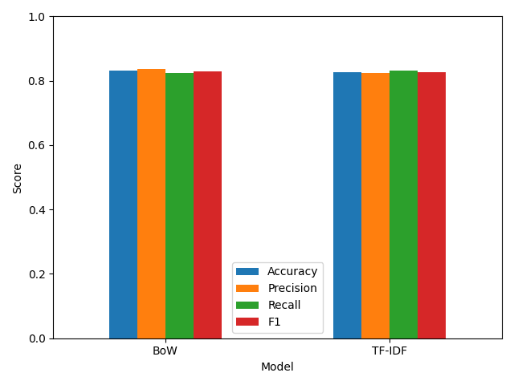
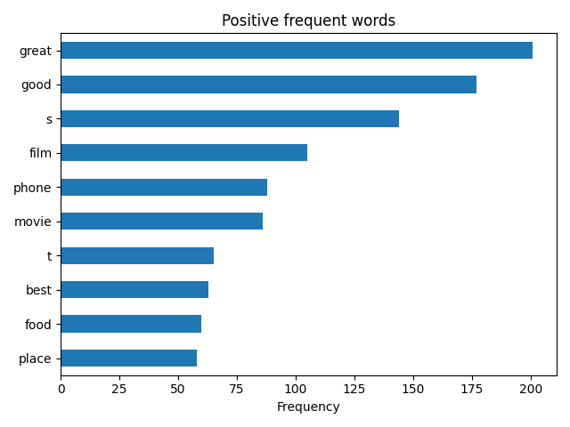
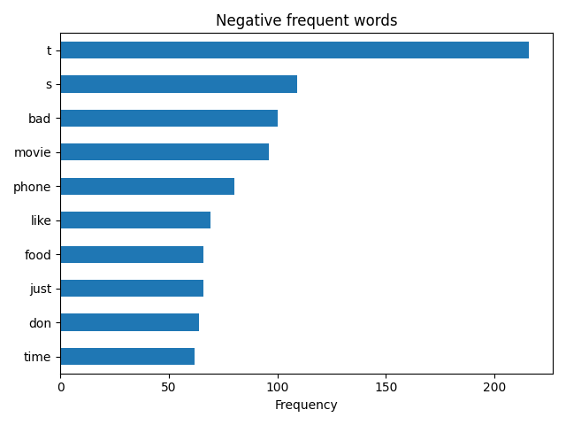

# Lab 01 – Sentiment Analysis Using Traditional Machine Learning

## Laboratory Session
PUSL 3205 – Large Language Models and Generative AI, Lab 01.

## Objective
Practice basic NLP tasks through text preprocessing, exploration, feature extraction and supervised sentiment classification.

## Tasks and Implementation
1. Load the [UCI Sentiment Labelled Sentences dataset](https://archive.ics.uci.edu/dataset/331/sentiment+labelled+sentences), containing Amazon, IMDb and Yelp reviews. Validate binary labels while parsing tab-separated records.
2. Convert text to lowercase, remove punctuation and unnecessary characters, normalize whitespace and create a `clean_text` column. Compare original and cleaned text.
3. Display positive and negative examples and plot the ten most frequent non-stopword tokens in each class.
4. Remove duplicate cleaned sentences and perform a stratified 80/20 train/test split with random seed 42.
5. Create Bag of Words (BoW) and TF-IDF feature representations, fitting vectorizers only on training data.
6. Train a Logistic Regression classifier for each representation.
7. Evaluate accuracy, precision, recall, F1 and confusion matrices on the held-out test set. Precision, recall and F1 refer to the positive class.
8. Predict sentiment for five new sentences using both models.

[Executed Jupyter notebook](notebooks/sentiment_analysis.ipynb)

## Results and Evidence
The dataset loaded successfully with 3,000 reviews (1,500 positive and 1,500 negative). After deduplication, 2,972 records remained: 2,377 training and 595 testing records. Each representation produced 4,530 training features.

| Model | Accuracy | Precision | Recall | F1 |
|---|---:|---:|---:|---:|
| BoW | 83.19% | 83.62% | 82.49% | 83.05% |
| TF-IDF | 82.69% | 82.33% | 83.16% | 82.75% |

[BoW confusion matrix](screenshots/BoW-confusion.png) · [TF-IDF confusion matrix](screenshots/TF-IDF-confusion.png) · [Exact metrics CSV](screenshots/metrics.csv)

### Word frequency analysis

### New sentence predictions
| Sentence | BoW | TF-IDF |
|---|---|---|
| The product is excellent and works perfectly. | Positive | Positive |
| The service was terrible and disappointing. | Negative | Negative |
| I would definitely recommend this restaurant. | Positive | Positive |
| I regret buying this phone. | Negative | Negative |
| The food was not good. | Negative | Negative |

[Predictions CSV](screenshots/predictions.csv). Both models agreed with the intended sentiment of all five examples; this small demonstration is not a separate estimate of generalization accuracy.

### Colab execution evidence
[Dataset loading](screenshots/colab-dataset.png) · [Preprocessing](screenshots/colab-preprocessing.png) · [Evaluation](screenshots/colab-comparison.png) · [Predictions](screenshots/colab-predictions.png)

## Observations
BoW achieved slightly higher accuracy, precision and F1, while TF-IDF achieved slightly higher recall. The accuracy difference was about 0.50 percentage points on this split; this alone does not establish that BoW is generally superior. Negative reviews frequently contained the word “bad”. Domain words such as “food” and “movie” also occur and do not necessarily indicate sentiment. The frequency chart contains contraction fragments such as “t” and “s” because punctuation removal splits contractions; improved tokenization would make exploration more meaningful. The initial dataset parser encountered missing labels, which was resolved by validating tab-separated records before integer conversion. Both unigram models ignore word order and can struggle with negation and sarcasm, even though both correctly classified the example “The food was not good.”

## Learning Outcomes
This activity demonstrates text cleaning, exploratory analysis, stratified splitting, sparse feature extraction, supervised classification, avoiding feature-extraction leakage, and interpreting classification metrics and limitations.

## Running the notebook
Open the notebook in Google Colab and select Runtime → Run all, or install dependencies with `pip install -r requirements.txt` and run in Jupyter. If automatic dataset download fails, place the UCI ZIP beside the notebook as `sentiment.zip`. The notebook contains outputs from the completed Colab run.
