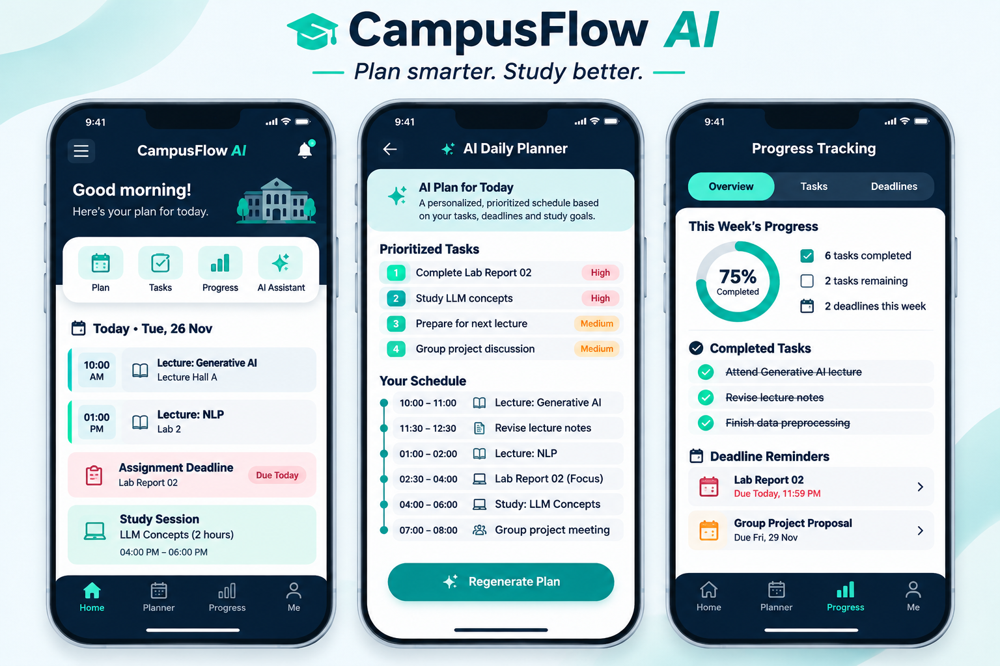

# Lab 02 – AI in Everyday Challenges

**Module:** PUSL3205 – Large Language Models and Generative AI  
**Selected challenge:** Group 5 – The Busy Student

## Objective
Apply an LLM to an everyday student challenge and explore how AI supports creativity, critical thinking and product development.

## Tasks and Implementation
University students must balance lectures, assignments, projects and personal commitments. CampusFlow AI is a proposed mobile planner that combines these commitments into a manageable schedule.

**Product name:** CampusFlow AI  
**Tagline:** Plan smarter. Study better.  
**Target users:** University students managing multiple academic and personal responsibilities.

| Feature | Purpose |
|---|---|
| AI daily planner | Suggest time blocks based on deadlines, availability and estimated task duration. |
| Task prioritisation | Highlight urgent and important tasks. |
| Deadline reminders | Notify students of approaching submissions. |
| Timetable management | Keep fixed lectures separate from flexible study tasks. |
| Progress tracking | Display completed and remaining tasks. |
| Rescheduling | Suggest alternative time blocks when plans change, subject to user approval. |

ChatGPT was used as a product-development partner to select a challenge, develop a product concept and create a visual mock-up. A proposed implementation would use an LLM to suggest schedules, with deterministic checks for overlapping events and user confirmation before changes.

## Results and Evidence
The concept and visual prototype were produced. The prototype illustrates the home dashboard, AI daily planner and progress tracking screens. It is a static design, not an implemented or tested application. All displayed schedule and progress data are illustrative.

See [activity outcomes](group-activity/activity-outcomes.md) and [discussion summary](group-activity/discussion-summary.md) for additional design details.

## Observations
An LLM can rapidly generate product ideas and organise features around a real-world problem. However, suggested schedules may contain conflicts or unrealistic workloads. A practical system would need availability checks, user control and protection of personal timetable data. The mock-up communicates the intended experience but does not demonstrate functional performance.

## Learning Outcomes
- Apply generative AI to a practical student problem.
- Translate user needs into a product concept and feature set.
- Use an LLM to support ideation and visual prototyping.
- Recognise the importance of validating AI-generated recommendations.
