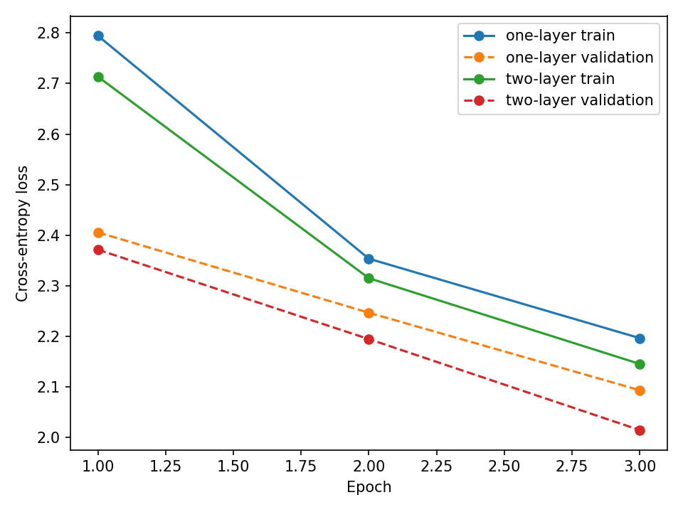

# Lab 03 – Developing a Tiny Transformer Language Model

**Module:** PUSL3205 – Large Language Models and Generative AI

## Objective
Implement a causal Transformer from scratch in PyTorch for character-level next-token prediction, evaluate its performance and compare model depths.

## Tasks and Implementation
1. Load the [TinyStories dataset](https://huggingface.co/datasets/roneneldan/TinyStories) using streaming: 1,500 training stories and 200 validation stories. Display examples and descriptive length statistics.
2. Build a character vocabulary from training text only, mapping unseen characters to an unknown token.
3. Sample 64-character input sequences and targets shifted by one character.
4. Implement learned token and positional embeddings, masked multi-head self-attention, feed-forward layers, residual connections and pre-layer normalization.
5. Initialize one-layer and two-layer models with four attention heads and embedding dimension 96. Use cross-entropy and AdamW (learning rate 0.001).
6. Train each model for three epochs of 100 sampled mini-batches (batch size 32), using backpropagation and gradient clipping.
7. Record training and validation loss and plot learning curves.
8. Evaluate on 30 reproducibly sampled validation batches per epoch; character-level perplexity is exp(validation loss).
9. Generate 200 new characters from the prompt “Once upon a time” using temperature sampling (0.8).
10. Compare model depths under the same training budget.
11. Save both state dictionaries, vocabulary and configuration.

## Results and Evidence

| Model | Final training loss | Final validation loss | Perplexity |
|---|---:|---:|---:|
| One-layer | 2.1961 | 2.0930 | 8.1094 |
| Two-layer | 2.1451 | 2.0141 | 7.4943 |

The [executed notebook](notebooks/tiny_transformer.ipynb) contains the implementation and outputs. Additional evidence: [training history](results/training_history.csv), [evaluation](results/evaluation.csv), [generated stories](results/generated_stories.json), [configuration](results/configuration.json), [one-layer weights](results/one-layer.pt), and [two-layer weights](results/two-layer.pt).

## Observations
Both models showed declining training and validation loss over the three epochs. The two-layer model achieved approximately 7.58% lower perplexity than the one-layer model in this experiment. Generated text included recognizable words but also malformed words and incoherent sentences. Lower character-level perplexity does not guarantee coherent stories. Limited training, small model capacity and character-level tokenization may contribute to these limitations. A single run does not establish that deeper models always perform better.

### Mechanisms used to improve performance
Causal masking prevents future-token leakage. Multi-head attention captures different contextual relationships. Positional embeddings preserve sequence order. Residual connections and layer normalization support stable gradient flow. AdamW and gradient clipping help stabilize optimization; dropout provides regularization. Validation monitoring helps assess generalization. More training, larger context windows and subword tokenization could be explored in future experiments.

## Learning Outcomes
- Understand causal self-attention and Transformer architecture.
- Prepare shifted input and target sequences for language modeling.
- Train and evaluate a neural language model using loss and perplexity.
- Compare model configurations and interpret generated text limitations.
- Save model weights and configuration for future use.

## Reproduction
Open the notebook in Google Colab and run all cells. A GPU is recommended; CPU fallback is supported. Dependencies are listed in requirements.txt. Results may vary across hardware and software versions. The optional Gradio interface was not implemented.
