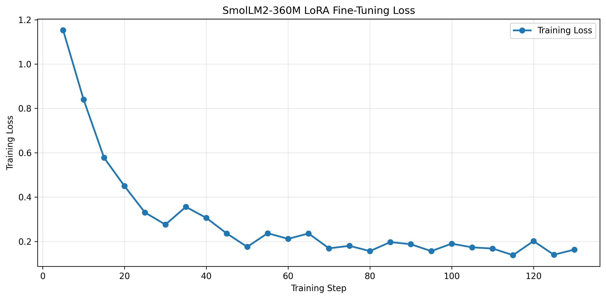
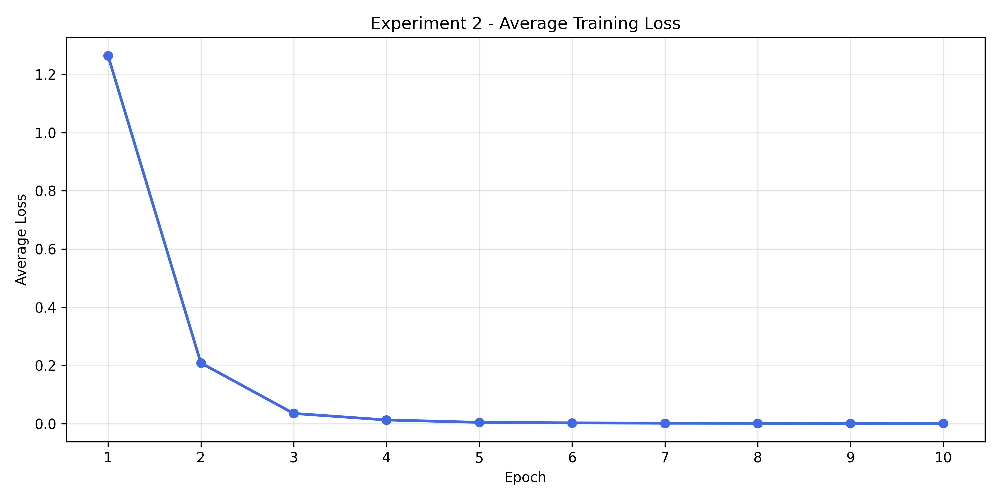
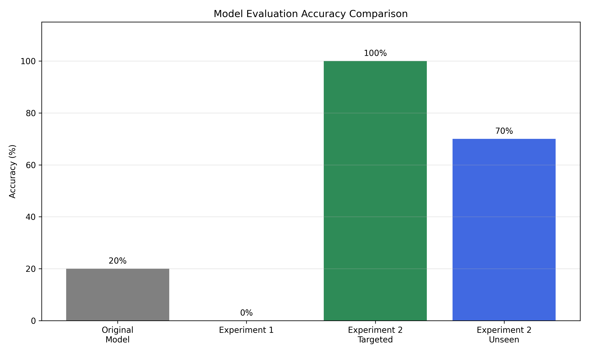

# Lab 04 - Fine-Tuning an LLM Using LoRA

## Objective

Fine-tune a pretrained instruction-tuned large language model using Low-Rank Adaptation (LoRA) for a domain-specific customer service application.

## Development Environment

- Platform: Kaggle Notebooks
- GPU: NVIDIA Tesla T4
- GPU memory: Approximately 15 GB per GPU
- Base model: HuggingFaceTB/SmolLM2-360M-Instruct
- Programming language: Python
- Frameworks: PyTorch, Transformers, PEFT and TRL

GPUs accelerate model training through parallel computation and provide dedicated memory for model parameters, activations and gradients.

## Domain and Dataset

The selected domain is customer service for a fictional computer shop named TechNova Computers.

The dataset covers:

- Product availability
- Delivery charges
- Warranty policies
- Payment methods
- Computer repair services
- Student discounts
- Return policies
- Custom PC orders

The original dataset contains 50 question-answer pairs. An expanded dataset of 250 examples was created using question variations.

## LoRA Configuration

| Parameter | Value |
|---|---|
| LoRA rank | 16 |
| LoRA alpha | 32 |
| LoRA dropout | 0.05 |
| Trainable parameters | 8,683,520 |
| Total parameters | 370,504,640 |
| Trainable percentage | 2.3437% |
| Learning rate | 0.0002 |
| Epochs | 10 |

Standard LoRA was selected because the small pretrained model could fit within the available GPU memory without 4-bit quantization.

## Experiment 1 - Initial Fine-Tuning

The first experiment used 50 training examples and TRL SFTTrainer with full-conversation loss.

- Training steps: 130
- Training duration: 49.30 seconds
- Average training loss: 0.2925
- Peak GPU memory: 2.39 GB
- Evaluation accuracy: 0%

Although training loss decreased, the model failed to learn the correct domain-specific facts reliably.

## Experiment 2 - Improved Fine-Tuning

The second experiment started from a fresh pretrained model and introduced:

- Expanded dataset of 250 examples
- Multiple question variations
- Assistant-only loss masking
- Custom PyTorch supervised training loop
- Single-GPU training
- Mixed-precision computation

System and user tokens were masked using the label -100, allowing the loss calculation to focus on assistant responses.

### Training Results

| Metric | Value |
|---|---|
| Training steps | 630 |
| Training duration | 168.44 seconds |
| Average training loss | 0.1533 |
| First epoch loss | 1.2639 |
| Final epoch loss | 0.0011 |
| Peak GPU memory | 1.93 GB |

## Model Evaluation

The original and fine-tuned models were evaluated using the same five questions. Correctness was assessed manually against the expected answers.

| Evaluation | Correct Answers | Accuracy |
|---|---|---|
| Original pretrained model | 1/5 | 20% |
| Experiment 1 | 0/5 | 0% |
| Experiment 2 - Targeted evaluation | 5/5 | 100% |
| Experiment 2 - Additional unseen questions | 7/10 | 70% |

The five targeted evaluation questions influenced the dataset improvements. Therefore, their results are reported separately from the ten additional unseen questions.

## Example Model Responses

| Question | Original Model | Improved Model |
|---|---|---|
| Laptop warranty | 24 months | Two years |
| Colombo delivery charge | Unknown | LKR 500 |
| Student discount | Unknown | 5% with valid student ID |
| Custom PC advance | 10% | 20% |
| Product return period | 30 days | Seven days with original receipt |

## Limitations

The fine-tuned model occasionally confuses numerical values between similar policies, particularly delivery charges and repair service prices.

The extremely low training loss also suggests possible overfitting. A larger and more diverse dataset would be required to improve generalization.

## Conclusion

LoRA enabled domain-specific fine-tuning while updating only approximately 2.34% of the model parameters.

The improved training methodology increased targeted evaluation accuracy from 0% to 100% and achieved 70% accuracy on additional unseen questions.

The experiments demonstrate the importance of dataset quality, loss masking and independent evaluation when fine-tuning large language models.

## Repository Contents

- `notebooks/` - Complete fine-tuning notebook
- `dataset/` - Original and expanded datasets
- `results/experiment_1/` - Initial experiment results and adapter
- `results/experiment_2/` - Improved experiment results and adapter
- `requirements.txt` - Python dependencies
