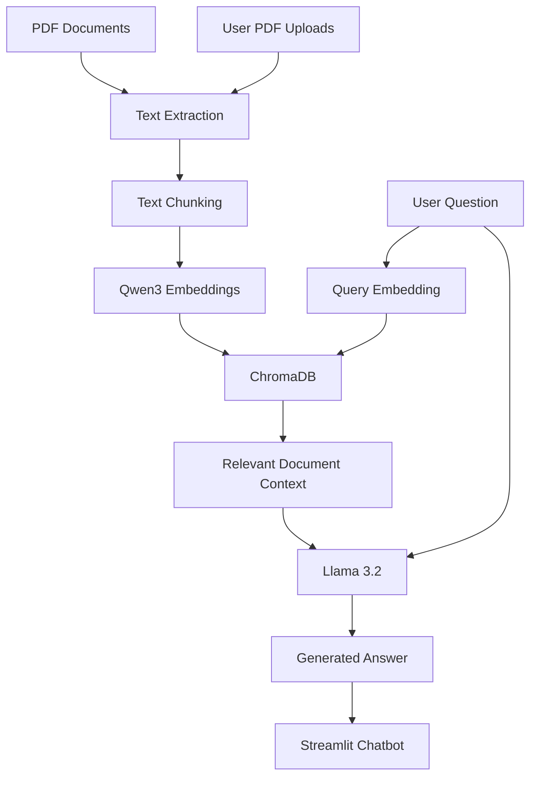
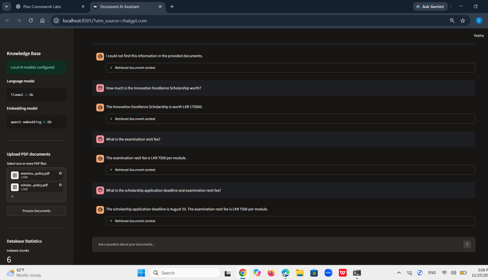
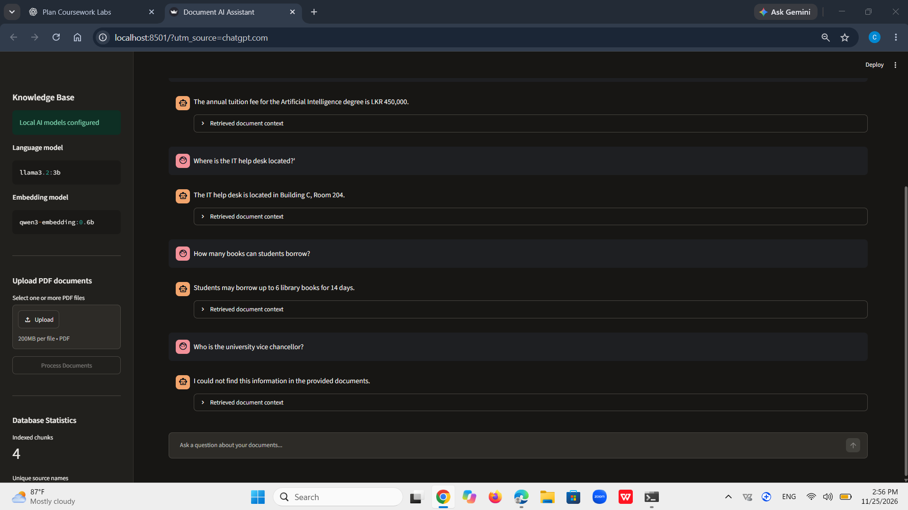

# Lab 05 - Retrieval-Augmented Generation (RAG)

## Module

PUSL3205 - Large Language Models and Generative AI

## Objective

Develop a local Retrieval-Augmented Generation pipeline capable of
answering questions using multiple PDF documents and supporting
dynamic user-uploaded documents through a chatbot interface.

## Technologies Used

- Python 3.12.10
- Ollama
- Llama 3.2 3B
- Qwen3 Embedding 0.6B
- LangChain
- ChromaDB
- PyMuPDF
- Streamlit

## System Architecture



## Implementation

The system extracts text from PDF documents using PyMuPDF.
The extracted text is divided into chunks of 500 characters
with an overlap of 100 characters.

Qwen3 generates 1024-dimensional embeddings, which are stored
in a persistent ChromaDB vector database.

When a user submits a question, the system retrieves the three
most relevant document chunks and provides them to Llama 3.2
as contextual information for answer generation.

## Features

- Local language model inference
- Multiple PDF document ingestion
- Semantic similarity search
- Persistent vector database
- Dynamic PDF uploads
- Duplicate chunk prevention
- Retrieved source and page references
- Interactive Streamlit chatbot
- Cross-document question answering
- Prompt-based hallucination mitigation

## Project Structure

```text
Lab-05-RAG-Pipeline/
|-- documents/
|-- screenshots/
|-- results/
|   |-- evaluation.csv
|-- create_sample_documents.py
|-- create_upload_test.py
|-- ingest.py
|-- rag_pipeline.py
|-- app.py
|-- requirements.txt
|-- .gitignore
|-- README.md
```

## Installation

Install Python 3.12 and Ollama.

Create and activate a Python virtual environment:

```powershell
py -3.12 -m venv rag_env
.\rag_env\Scripts\Activate.ps1
pip install -r requirements.txt
```

Download the required models:

```powershell
ollama pull llama3.2:3b
ollama pull qwen3-embedding:0.6b
```

## Running the Application

Generate sample documents if required:

```powershell
python create_sample_documents.py
```

Index the documents:

```powershell
python ingest.py
```

Run the command-line RAG pipeline:

```powershell
python rag_pipeline.py
```

Launch the chatbot:

```powershell
python -m streamlit run app.py
```

Open http://localhost:8501 in a browser.

## Custom PDF Uploads

The Streamlit interface allows users to upload multiple PDF
documents simultaneously. Uploaded documents are processed,
embedded and added to the existing vector database.

Additional test PDFs can be generated using:

```powershell
python create_upload_test.py
```

These files are generated in the user's Downloads folder.

## Evaluation Results

| Evaluation | Result |
|---|---|
| Original PDF documents | 3 |
| Dynamically uploaded PDFs | 2 |
| Total indexed chunks | 6 |
| Embedding dimensions | 1024 |
| Test questions | 8 |
| Correct responses | 8 |
| Observed test accuracy | 100% |
| Unanswerable question test | Passed |
| Cross-document retrieval | Passed |

The evaluation results are available in
[results/evaluation.csv](results/evaluation.csv).

The observed accuracy applies only to the eight manually
evaluated questions and does not establish general accuracy.

## Screenshots

### RAG Chatbot



### Custom PDF Uploads



## Limitations

- Scanned PDFs require additional OCR support.
- Response speed depends on available hardware.
- Generated answers may still contain inaccuracies.
- Uploaded documents remain in the local shared vector database.
- Chat history is displayed but is not used for conversational retrieval.
- Sentence Transformers was not installed because embeddings
  are generated directly through Ollama.

## Conclusion

The developed system demonstrates the integration of document
processing, vector embeddings, semantic retrieval and local
language model inference. The application successfully answers
questions using multiple PDF documents and supports dynamic
document uploads through an interactive chatbot.

All sample university documents contain fictional information
created specifically for educational testing.
